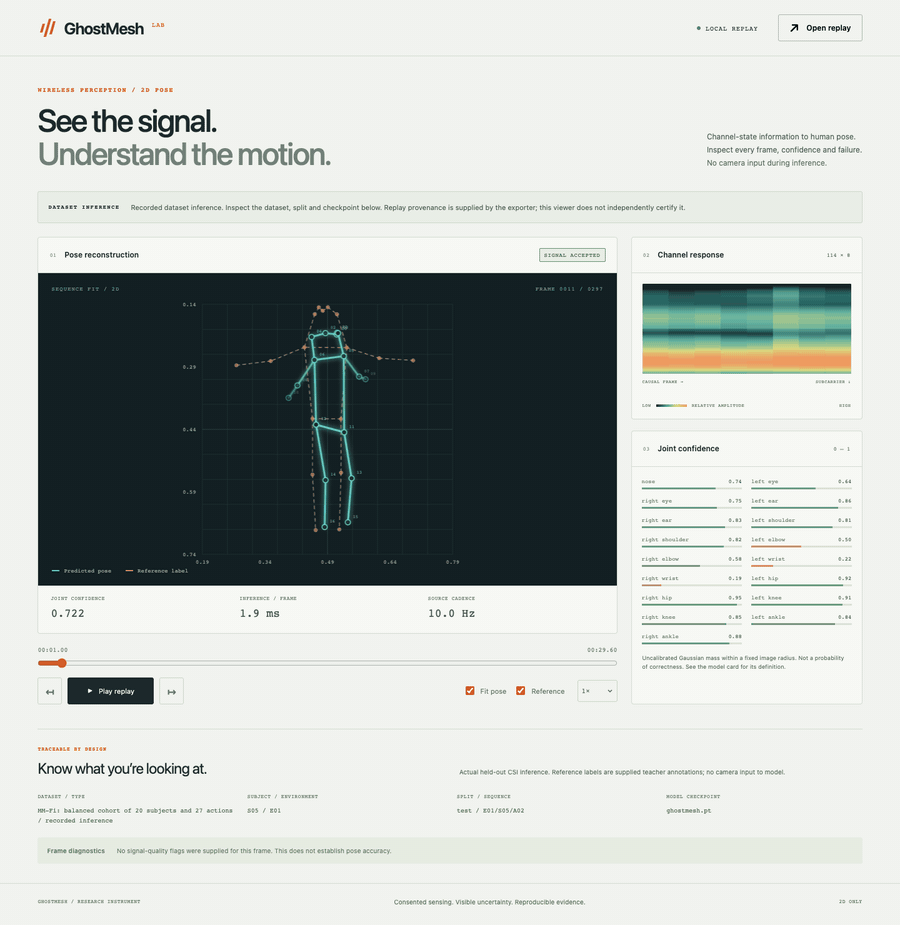
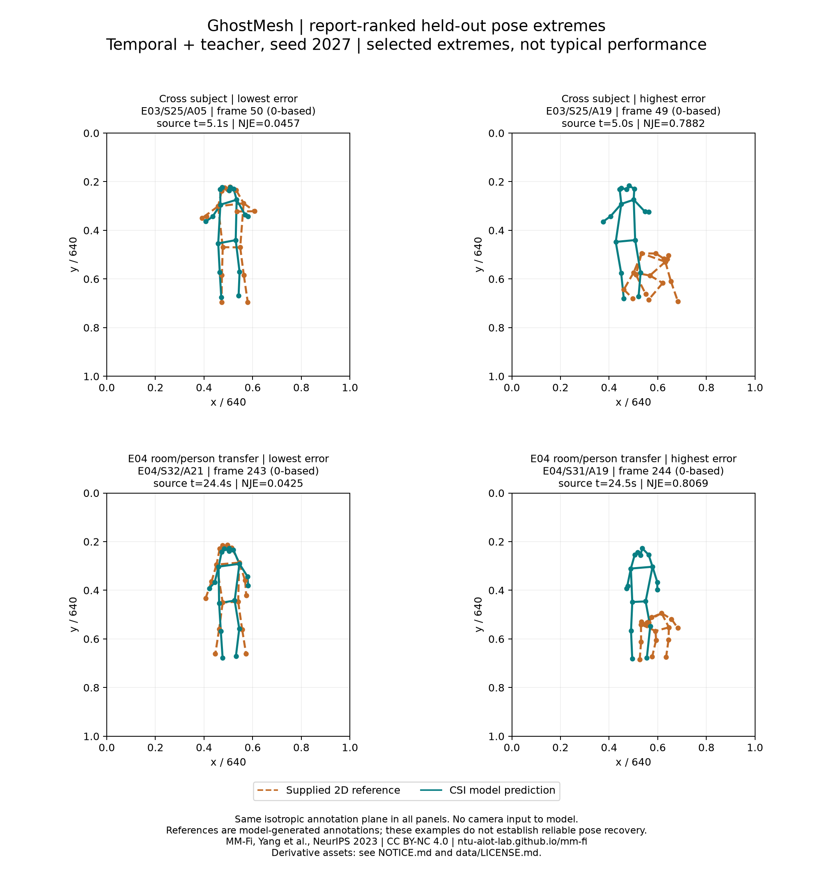

# GhostMesh

[](https://github.com/nazeeh111/GhostMesh/actions/workflows/ci.yml)

**Camera-free 2D pose inference. Real held-out data. Inspectable uncertainty.**

Channel-state information (CSI) describes how Wi-Fi signals change along radio
paths. GhostMesh implements an original CSI-to-pose pipeline and a local
application for inspecting its 17-joint predictions, signal maps, confidence
and reference annotations. Inference consumes CSI alone.

**Research finding:** the completed study is mixed. Temporal encoding and
teacher consistency did not consistently improve the simpler neural baseline.
Room-specific pose priors are strong, fine joint accuracy remains low, and
unseen-room confidence is unreliable. This release documents those limits
alongside the working software. Robust dynamic pose recovery and “10×”
superiority are not established.

**Measurement correction:** the audited MM-Fi magnitude field is already
logarithmic; v0.1 adds another nonlinear compression. Its reported results
remain measurements of that frozen transform. [Details and reproducible unit check](docs/ERRATA.md).

**v2 research:** full 40-person data access is restored and its bytes are verified.
Corrected-signal and calibration experiments have not established reliable motion
transfer. [Current findings, failed comparisons and protected final protocol](docs/DOMAIN_RESEARCH.md).

A separate **local motion diagnostic** now reconstructs later time blocks of one
recording, with relative motion R² **0.917** and NJE **0.02466**. It uses dense
references from the same person, room and action. Its compact model and CSI-only
sample reproduce all 104 held-time predictions. This result supports learning
from CSI, while unseen-room performance remains unresolved.
[Evidence, controls and limitations](docs/LOCAL_OBSERVABILITY.md).

The new receiver-covariance candidate also lowers pooled **hip-relative** error
against a source static prior in three development rooms on three fixed actions.
Its motion gains are small and reverse for several people and actions. The full
27-action follow-up loses to the static pose prior in E02. Full pose and useful
calibrated transfer remain unresolved.
[Exact scores and reversals](docs/COVARIANCE_RESEARCH.md).
Further [packet-spectrum experiments](docs/PACKET_TIME_RESEARCH.md) retain
within-window frequency information, but also fail the consistent transfer gate.



*Actual E01/S05/A02 test recording, selected before test scores. Teal is the
prediction; dashed orange is the supplied 2D teacher annotation, attached after
inference. Motion is captured from the application at source timestamps.*

[Run the app](#run-locally) · [Measured findings](results/README.md) ·
[Model card](docs/MODEL_CARD.md) · [Reproduce](docs/REPRODUCE.md) ·
[Release downloads](https://github.com/nazeeh111/GhostMesh/releases/tag/v0.1.0)

## Run locally

Python 3.12 and [uv](https://docs.astral.sh/uv/) are the tested environment.
The recorded viewer needs only Python's standard library:

```bash
git clone --branch research/domain-generalization-v2 https://github.com/nazeeh111/GhostMesh.git
cd GhostMesh
uv run --isolated --no-project --python 3.12 python -m ghostmesh serve
```

Open the printed localhost address. Play, pause, step, seek, change speed and
toggle reference labels or the fixed isotropic viewport. The app shows the
causal CSI amplitude map and per-joint uncertainty. Invalid signal withholds
the pose; domain warnings identify known or unverified domains. Opening another
replay stays inside the browser. The viewer plays saved predictions.

These commands select the published v2 research branch. The frozen v0.1 release
and its original study remain available from the release downloads.

To compute predictions from the shipped CSI-only sample, install the ML stack:

```bash
uv sync --locked --extra test
uv run ghostmesh infer-recording --recording examples/heldout-csi.npz \
  --checkpoint models/ghostmesh.pt --out examples/recomputed.json
uv run ghostmesh serve --replay examples/recomputed.json
uv run python scripts/reproduce_demo.py
```

Both released examples reproduced all **290 valid frames exactly** from files
containing only CSI and timestamps. Seven initial frames provide causal context.
The separate [E04 replay](examples/unseen-room-replay.json) uses its own model:

```bash
uv run ghostmesh serve --replay examples/unseen-room-replay.json
```

No boards, camera, cloud account or billed API are required for these paths.

### Inspect the local motion diagnostic

This optional example uses 111 dense reference windows from E01/S01/A12 and
104 separated held-time windows from that same recording. It is a research
diagnostic. It does not demonstrate unseen-person/room/action transfer or a small
room-calibration budget. Confidence is explicitly unavailable for this kernel
model. The default released neural models remain unchanged.

```bash
uv run ghostmesh serve --replay examples/local-motion-replay.json
uv run python scripts/local_kernel_replay.py infer \
  --model models/local-kernel.npz --recording examples/local-csi.npz \
  --out work/local-recomputed.json
uv run ghostmesh serve --replay work/local-recomputed.json
```

The second command loads no annotations. The supplied replay adds reference
overlays after inference. The CSI excerpt, reference CSI inside the checkpoint,
predictions and overlays retain the [MM-Fi noncommercial data terms](data/LICENSE.md).


*Three seconds captured from the real app at nominal dataset timestamps. Teal
shows CSI predictions; dashed orange shows supplied annotations attached after
inference. [Capture provenance](docs/assets/local-motion-v2/capture.json).*

## Measured study

The cohort contains **27 actions, 20 people, four environments, 540 sequences
and 160,380 paired frames**. Twelve neural arms each trained for 40 epochs;
epochs were selected by validation error. Test windows are dense and remain
within held-out people. All action categories occur in development.

The predeclared temporal-plus-teacher model, seed 2027:

| Test protocol | People | PCK@.05 | PCK@.2 | NJE ↓ | Forward median / FPS |
|---|---:|---:|---:|---:|---:|
| New people, represented rooms | 4 | 13.20% | 82.74% | 0.13429 | 1.060 ms / 943 |
| E04 room/person transfer | 5 | 2.36% | 49.22% | 0.21440 | 0.827 ms / 1,209 |

PCK counts joints within the stated fraction of the reference body's bounding-box
diagonal. NJE is mean error divided by that diagonal. References are supplied
model-generated 2D labels. Forward timing is batch-one CPU computation on an
Apple M4, excluding preprocessing, acquisition, I/O and rendering. The recording
remains **10 Hz**, with about **0.7 seconds** of initial context.

- **Temporal gains are inconsistent.** The primary cross-subject model loses
  to the last-frame encoder. E04 improves at seed 2027 and reverses at seed 2028.
- **Static room information matters.** A source-trained room mean with oracle
  room metadata reaches NJE 0.13012 / PCK@.2 85.38%, beating both seed-2027
  cross-subject neural models.
- **Signal correspondence is modest.** Fixed within-room CSI permutation
  increases primary temporal NJE from 0.13429 to 0.13760 in cross-subject testing
  and from 0.21440 to 0.21725 in E04. These are descriptive controls, not proof
  of causal motion sensing. E04 baseline PCK improves under permutation.
- **Confidence needs caution.** Primary expected calibration error is 0.1406
  in cross-subject testing and 0.4183 in E04, for a fixed annotation-plane radius.
  Joint scores are uncalibrated model quantities.

[All seeds, thresholds, ablations and paired intervals](results/cohort20-v1/results.md) ·
[Room-prior and permutation diagnostics](results/signal-controls-v1/README.md)




The qualitative panels are metric-ranked extremes, not typical performance.
The study uses four or five held-out people per protocol. Room and person
changes are confounded in E04. Full 40-person, unseen-action, cross-device,
multi-person, 3D and reliable real-world pose recovery are unvalidated.

## What is original

- Exact frame pairing, integrity-checked manifests, causal windows and per-link
  robust normalization, with no statistics fitted on future frames.
- A compact packet-moment spectral encoder and causal temporal model with
  54,451 parameters, compared with a last-frame encoder sharing preprocessing.
- A source-only moving-average teacher with bounded uncertainty weighting,
  gain perturbation and subcarrier masking, evaluated through declared ablations.
- Frozen experiment and diagnostic plans, validation-only checkpoint selection,
  matched static priors, sequence/subject bootstrap intervals and signal controls.
- An offline replay instrument with real-data provenance and camera-free
  inference reproduction, backed by meaningful automated checks.

The method builds on established temporal-convolution and mean-teacher ideas.
Its value is assessed by the measured study; no first-ever or state-of-the-art
claim is made. No upstream model code, weights, research figures or demos were
copied. [Research references and source boundaries](docs/REFERENCES.md).

## Data and full reproduction

The release provides an optional **exact prepared cohort download** and a
separate study archive containing all selected checkpoints, original reports,
manifests and hashes. This allows independent evaluation of the 20-person study
without upstream access. Data and derived assets retain **CC BY-NC 4.0** terms
and the MM-Fi authors' attribution. [Data terms](data/LICENSE.md).

To acquire from the original source instead:

```bash
uv run python scripts/fetch_cohort20.py --dry-run
uv run python scripts/fetch_cohort20.py --inventory
uv run python scripts/fetch_cohort20.py --out data/mmfi-raw
uv run ghostmesh prepare-mmfi \
  --source data/mmfi-raw --out data/mmfi-prepared \
  --width 640 --height 640 --fps 10 \
  --subjects S01 S02 S03 S04 S05 S11 S12 S13 S14 S15 \
    S21 S22 S23 S24 S25 S31 S32 S33 S34 S35 \
  --provenance configs/cohort20-provenance.json
uv run ghostmesh audit --manifest data/mmfi-prepared/manifest.json
```

The v0.1 40-person expansion stopped at a verified provider quota; its study
therefore remains the frozen 20-person cohort. Normal access returned during
v2 research, and the full 40-person acquisition now passes byte verification.
The 640-square annotation plane is an
explicit isotropic convention, not recovered camera calibration. Original
packet-level synchronization was not independently verified.
[Data access, consent basis and exact splits](docs/DATA_ACCESS.md).

For an exact new registered study, first extract the prepared release archive
and copy its `data/mmfi-cohort20` folder into a fresh checkout, preserving the
released manifests and matching provenance receipt. Fresh preparation can
change manifest bytes and needs a separate matching provenance record.
The launcher freezes supplemental controls before testing and then runs the
unchanged twelve-arm CPU suite:

```bash
uv run python scripts/run_study.py \
  --subject-manifest data/mmfi-cohort20/manifest.json \
  --environment-manifest data/mmfi-cohort20/cross-environment.json \
  --out experiments/my-study --controls-out results/my-controls
```

For individual training and evaluation:

```bash
uv run ghostmesh train --manifest data/mmfi-prepared/manifest.json \
  --config configs/cohort20-temporal.json --out experiments/my-run
uv run ghostmesh evaluate --manifest data/mmfi-prepared/manifest.json \
  --checkpoint experiments/my-run/best.pt --out experiments/my-run/test.json
```

[Complete reproduction and recovery guide](docs/REPRODUCE.md) ·
[Study archive and chart rendering](docs/STUDY_BUNDLE.md)

## Verification

```bash
uv run pytest -q --ignore=tests/test_report_results.py
node --test tests/test_replay.mjs
```

Checks cover numerical causality and gradients, real loader contracts, split
leakage, integrity, validation-only selection, exact epoch recovery, metrics,
uncertainty, frozen plans, CSI-only inference, serial parsing, actual HTTP
responses and replay controls. Reporting checks run in a separate optional
environment. CI also recomputes the real shipped replay and verifies the
installed wheel outside the checkout. [Evidence and limits](docs/VERIFICATION.md).

## ESP32 mode

Hardware acquisition is a separate opt-in signal path. It requires a real
ESP-CSI device, a selected serial port and consenting participants:

```bash
uv sync --locked --extra hardware
uv run ghostmesh esp-record --port /dev/cu.YOUR_DEVICE --out data/my-session \
  --seconds 60 --consent-note "Consenting participants in the authorized test area"
uv run ghostmesh esp-convert --source data/my-session/serial.log \
  --out data/my-session/amplitude.npz
```

The recorder and converter do not estimate ESP32 pose. MM-Fi weights require
their original sensor layout; transfer by reshaping is rejected. Physical
capture and ESP32 pose accuracy remain unverified. [Hardware guide](docs/HARDWARE.md).

## Repository map

| Path | Purpose |
|---|---|
| `ghostmesh/` | Preparation, model, training, evaluation, inference and local server |
| `ghostmesh/web/` | Browser app without a CDN or build service |
| `configs/` | Versioned model and diagnostic definitions |
| `models/`, `examples/` | Licensed weights and real CSI-only replay inputs |
| `results/` | Measured findings, controls, qualitative cases and artifact hashes |
| `scripts/`, `tests/` | Reproduction, packaging, capture and verification |
| `docs/` | Model, data, protocols, hardware limits and research references |

Original software: [MIT](LICENSE). MM-Fi data, trained weights and derived
replay/figure assets: [CC BY-NC 4.0](data/LICENSE.md). [Attribution](NOTICE.md).
Use authorized recordings from consenting people. GhostMesh is a single-person
2D research system; it does not provide surveillance, identification or medical
safety decisions.
