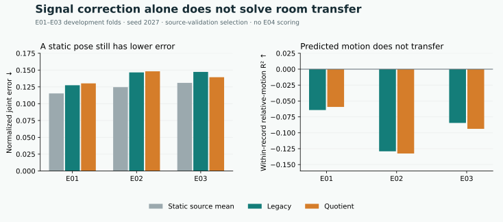

# Domain generalization research, v2 development

**Status: incomplete. No replacement model has demonstrated consistent baseline improvement.** The released application and v0.1 weights remain the supported replay path. This research branch preserves unsuccessful experiments and keeps its final E04 recording arrays sealed.

## What the measurements establish

The original MM-Fi magnitude interpretation was incorrect. Original double-precision magnitude and phase reconstruct integer complex coefficients for all 411,369,834 finite source samples when magnitude is interpreted as 20 log10, with maximum rounding residual 3.979e-13. This is empirical evidence of receiver-relative log magnitude, not calibrated RSSI/dBm or ADC samples. See the [measurement erratum](ERRATA.md). An interpretation correction does not establish a model improvement; old measured scores remain valid for their frozen transforms.

The strongest small-model failures involve transfer rather than basic learning capacity. A controlled model fits one real 296-frame source recording with relative training-motion R² approximately 0.988. Shuffling its raw inputs destroys the fit. That recording has little motion, all frames were training examples, and this establishes neither unseen-person accuracy nor a quotient-feature advantage.

Static pose priors are strong. Report the source-only mean skeleton alongside learned models. Motion R² subtracts each recording's mean target and prediction before comparing squared error; 0 is the static reference and negative values indicate unhelpful predicted fluctuations. Low aggregate error alone is insufficient evidence of motion reconstruction.

## Corrected-signal comparison

These are **development** room-held folds on E01–E03, one training seed 2027. Each fold uses 8 source training people, 2 different source-validation people and 5 people in the held room. Complete recordings and people stay together. Each model receives 7,992 nonoverlapping 8-frame windows with dense 63,936-frame training supervision, 12 epochs and the same source-validation checkpoint rule.

MM-Fi assigns different people to each room, so room-held folds test combined room/person shift. They do not isolate the two causes.

The legacy arm is a new matched encoding control, not the entire released v0.1 model. Both arms share a new packet-attention/causal temporal body model, an independent root-position network, targets, optimization and raw log-magnitude root inputs. The body inputs differ: original compressed magnitudes versus clipped log-polar inter-receiver quotients. Equal input shape does not make zero-padded channels useful parameters.

| Held development room | Source mean NJE | Legacy NJE | Quotient NJE | Legacy PCK@.05 | Quotient PCK@.05 |
|---|---:|---:|---:|---:|---:|
| E01 | 0.115310 | 0.127445 | 0.130235 | 0.213979 | 0.171842 |
| E02 | 0.124649 | 0.146533 | 0.148213 | 0.138433 | 0.140811 |
| E03 | 0.131004 | 0.147339 | 0.139454 | 0.094306 | 0.110087 |



NJE divides each joint's Euclidean error by that frame's provided 2D pose bounding-box diagonal; lower is better. PCK@.05 is the fraction within 5% of that diagonal. Both learned arms have negative within-record relative-motion R² in every fold. The quotient representation improves only one room's NJE. The independently optimized final root-network parameters are identical across paired arms. Selection often chooses epoch 1; retained selected-checkpoint results do not describe every later optimizer state. [Machine-readable scores and exact source/config/cache identities](domain-v2-dense-rf-results.json) accompany this table.

Additional bounded screens tested packet CNNs, longer moment contexts, phase channels, geometric factorization and source pose alignment. None qualified as a consistent improvement. Their source scripts write histories, weights, predictions, failure records and artifact hashes; these are experimental tools rather than additional production inference modes.

### Nonlinear dynamics and expanded source cohort

Window-centered nonlinear random Fourier features (RFF) carry a weak action signal: 6.56% mean accuracy on held development rooms, against 3.70% chance and 4.22% for a matched record-label permutation control. That gain does not carry over to pose motion. Dynamic RFF pose regression gives NJE 0.114851/0.126485/0.130256 on E01/E02/E03, versus matched static priors 0.115340/0.124612/0.130980. It loses to the static prior in E02, all three relative-motion R² values are negative, and shuffling its outputs within recordings slightly improves NJE. All saved selected model predictions reproduce exactly. [Compact pose scores and frozen recipe](domain-v2-rff-pose-results.json).

A subsequent raw-complex differential test uses the expanded 30-person source cohort, 32-frame causal context and 16/4/10 training/validation/held people per fold. Fixed random projection and RFF regression compare untreated inter-receiver quotients, causal per-subcarrier background subtraction and a frozen startup-channel control. Source-validation error selects regularization; pose and lag-8 displacement are separate targets. The model never receives action, subject or recording identifiers.

| Held development room | Untreated pose-motion R² | Background-residual pose-motion R² | Background-residual displacement R² |
|---|---:|---:|---:|
| E01 | -0.002656 | -0.000002 | -0.000151 |
| E02 | -0.003120 | -0.001281 | -0.000319 |
| E03 | -0.003977 | -0.002092 | -0.000872 |

The frozen channel control correctly has zero motion R². Background subtraction improves relative pose error in only one room and fails the preset continuation gate for positive motion in all rooms. These restricted learners do not establish that raw CSI lacks pose information; projection can lose information and subtraction can remove slow motion. They provide no evidence for adopting this candidate or increasing neural training on this hypothesis. [Complete compact scores, selection grids and source identities](domain-v2-background-results.json).

### Packet spectra and power normalization

A different representation retains nominal signed-frequency power within each
causal CSI window. Its raw-power and pointwise normalized versions use all 810
source recordings and 26,554 common endpoints. Normalization improves the matched
nonlinear displacement model in all three rooms, but the actual source-selected
family scores full-joint lag-eight displacement R² .002087/.000641/−.006688.
The E01 packet-permuted
control also beats its natural-order counterpart. Current full-pose NJE loses to
the static mean in two rooms. Both frozen continuation gates fail.

The [complete comparison](PACKET_TIME_RESEARCH.md) retains the stronger local
raw-CSI controls, every family and permutation arm, person/action reversals,
nominal-clock limitations and public numerical verification commands. All 60
fitting equations per representation and saved predictions were checked. No
target references or reserved E04 arrays entered these experiments.

## Calibration is a separate task

A second objective predicts pose increments between disjoint eight-frame windows
from the same recording. This removes constant skeletons as a solution to its
training loss. It used paired initialization, windows and 1,000-step budgets,
with checkpoints selected by source-validation motion R². On E02, relative
increment R² was −0.03302 versus −0.03642 for the matched absolute objective;
the zero-increment control scores zero. Neither establishes transferable motion.
The increment model's arbitrary initial skeleton also prevents interpreting it
as a complete pose decoder. This diagnostic used no target calibration labels or
reserved E04 data. [Full motion scores, controls and frozen identities](domain-v2-increment-results.json).

A later paired learned-adaptation screen also failed: on the identical eight
E02 query people, ordinary training plus adaptation reached NJE 0.142987 and
training through the adaptation step reached 0.144288, versus source mean
0.112255. Both received the same 120 target-room reference poses from different
people. The zero-shot variants also lost to the static mean. All learned motion
R² values were negative. [Exact comparison and independent local-motion positive control](LOCAL_OBSERVABILITY.md).

Two modes are evaluated separately. Zero-shot models receive no target-room references. Room calibration receives explicit labeled reference poses; controls receive exactly the same references. Personal enrollment is additionally labeled as same-person adaptation.

The 120-reference room recipe used 2 people, 6 actions and 10 frames per action. It harmed mean performance in 2 of 3 development rooms. A second 108-reference recipe covered 4 people and all 27 actions, requiring 108 recordings rather than 12. Its best linear temporal Ridge achieved mean NJE 0.121134 versus source prior 0.123644, but motion R² remained negative for all 15 held people. Selected neural shrinkage ignored CSI and returned the calibration mean. A 60-reference personal-enrollment phase/RBF method gave NJE 0.104313 versus personal mean 0.105207, with negative motion R² for every person. Parameter choices minimize mean error on these same 15 development rotations; these are development findings, not independent confirmation or calibrated product claims. Reference collection burden and action coverage must accompany their scores.

## Data access and final-test protection

After a documented provider quota, one normal same-source request after 24 hours restored access. All 40 participants/all 27 actions are now present: 1,080 recordings and 320,760 paired frames. All 641,520 downloaded CSI MAT and supplied 2D-keypoint NPY files pass official ZIP byte-length/CRC checks. Exact paired frame001…297 filename sets were also checked. No RGB images were fetched or decoded. The [byte audit](domain-v2-full40-byte-audit.json) records source inventory and per-record hashes; hashing E04 bytes does not decode its arrays.

The new compact source cache includes E01–E03 only: 30 people, 810 recordings, 240,570 frames, original log magnitudes and phase plus provided 2D annotations. All source labels are valid under the declared 640×640 isotropic reference plane. That plane preserves pixel-distance geometry and is not recovered camera calibration. Data and derived artifacts retain the MM-Fi noncommercial attribution requirements. Source inclusion forfeits any later untouched-source-person claim for S10/S20/S30.

The [source cache audit](domain-v2-source30-audit.json) binds all three array hashes, exact amplitude/pose/validity agreement with 405 earlier independently prepared source recordings, and exact legacy/quotient preprocessing agreement for 1,215 windows. A supplemental byte verifier binds those comparisons to the actual reference cache inputs and preprocessing code. No prior result or receipt was rewritten.

[Primary final records](../configs/domain-v2-reserved-records.json) were frozen before array decoding: 14 new S36 recordings and S40 A02/A06. All 16 raw byte identities remain unchanged after the full download. E04 had historical exposure in v0.1, and the two primary strata have different actions. This cannot establish a wholly novel-room or population-wide result. A prospectively frozen [127-record expansion](../configs/domain-v2-reserved-expansion.json) may provide a separately reported confirmation after recipe selection. Neither set is available for tuning.

Before final scoring, freeze all checkpoints and training/config/source identities. Report all 5 paired seeds 2027–2031, both primary strata and all reversals. Consistency requires lower NJE for each seed pooled and within both strata, with mean PCK@.05/.2 no worse in either stratum. No candidate has reached that gate.

## Reproduce the source path

Use the locked environment described in [REPRODUCE.md](REPRODUCE.md). Fetch only CSI and supplied 2D labels with `python scripts/fetch_full40.py --inventory`, then `python scripts/fetch_full40.py --resume`. Inspect the inventories first; normal provider-access and resume checks apply. The four environments run sequentially and the first failure stops acquisition. `--dry-run` prints the exact commands without downloading. Do not substitute a random frame split.

For the released 20-person manifest and source cache, use fresh output directories:

```sh
python scripts/domain_probe.py build --manifest data/mmfi-cohort20/manifest.json --cache work/domain-dev-v2
python scripts/domain_stream_cache.py --manifest data/mmfi-cohort20/manifest.json --reference work/domain-dev-v2 --out work/domain-dev-stream8
python scripts/domain_rf_cache.py --manifest data/mmfi-cohort20/manifest.json --raw-root work/data/mmfi --reference work/domain-dev-v2 --out work/domain-dev-rf8
python scripts/domain_rf_probe.py --reference work/domain-dev-v2 --stream-cache work/domain-dev-stream8 --rf-cache work/domain-dev-rf8 --modes legacy quotient --device cpu --out work/dense-rf-reproduction
```

CPU and MPS runs record their execution device and need not produce bit-identical fitted weights. The cited table used MPS. These commands refuse to overwrite existing artifacts. No E04 data is loaded by these builders or trainer.

For the expanded cohort, first verify downloaded bytes using the four official inventories, then build source data:

```sh
python scripts/verify_mmfi_inventory.py --root work/data/mmfi --inventories work/references/full-v2 --reserved configs/domain-v2-reserved-records.json --output work/full40-byte-verification-v1.json
python scripts/domain_full_source_cache.py --raw-root work/data/mmfi --config configs/domain-v2-source30.json --byte-audit work/full40-byte-verification-v1.json --out work/domain-source30-rf-v1
python scripts/domain_background_probe.py --cache work/domain-source30-rf-v1 --out work/background-reproduction
```

These research tools intentionally make no arbitrary-room, ESP32 transfer, multi-person, 3D, medical or covert-monitoring claim. An improved model will require measured held-out evidence before it becomes the default.
