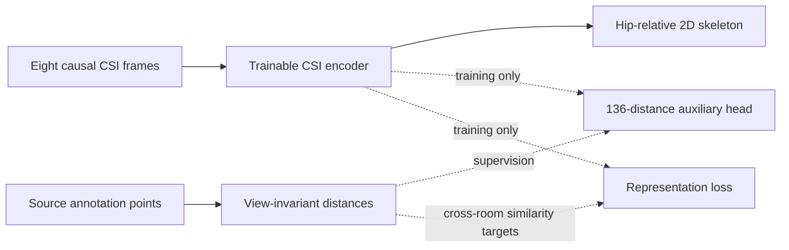

# Geometry supervision: a source-only test

**The candidate failed its source-person gate. It does not improve the released
model, establish unseen-room performance or validate room calibration.**

This study tests a different hypothesis from masked CSI reconstruction: can
view-invariant annotation geometry teach a more useful radio representation?
The [measured report](domain-v2-geometry-results.json) includes all controls,
failed gates, per-person/action scores, numerical audits and source hashes.
The [prospective training plan](geometry-distillation-plan.json) was frozen
before fitting. No new E02/E04 scores were taken.



## Annotation contract

Only the 540 numeric `ground_truth.npy` members in source rooms E01/E03 were
acquired from the official MM-Fi archives. Every member passed CRC, SHA256 and
length checks. All 160,380 frames are finite 17×3 float32 arrays. Images were
not acquired. The arrays retain MM-Fi's [noncommercial data terms](../data/LICENSE.md).

Their point indices are preserved. Anatomical names, physical units and a
mapping to the separate COCO 2D targets have not been independently established.
The target is therefore **136 indexed pairwise distances**, divided by each
frame's root-mean-square radius after centering. It is invariant to translation,
rotation, reflection and positive overall scale. It loses orientation and
chirality. It supplies extra training supervision, not reconstructed 3D pose.
The actual output head remains hip-relative COCO 2D.

The independent annotation audit reproduced all 17,670 source endpoint/frame
joins using SciPy's pairwise distances. Maximum target difference was
1.78×10⁻¹⁵. No frames were silently excluded from the annotation-quality audit.
The existing CSI-quality exclusions still determine the endpoint cohort.

## Frozen-feature feasibility

The existing masked, supervised and random encoders supply their full
512-dimensional histories. A raw-current nonlinear control uses its existing
512-dimensional map. Each receives ordinary and recording-fixed-effects ridge
readouts, with five regularization settings each: **40 configurations**, all
reported. Fixed-effects centering uses source training recordings only;
predictions never receive query means or annotations.

Sixteen people contribute 14,124 training endpoints. Four different people,
S04/S09/S24/S29, contribute 3,546 validation endpoints in the same two rooms.
All 27 actions are included. The primary masked/fixed-effects readout scores
shape-motion R² **0.01038** and lag-eight displacement R² **0.01647**. Its
geometry MSE **0.063695** loses to the static reference **0.063221**, and the
predeclared gate fails. This small positive motion signal does not establish
useful pose reconstruction.

A separate numerical audit reconstructed all 40 regularized equations using
general LU solves, reproduced all eight selections and found zero metric
disagreements. Maximum relative equation residual was 8.01×10⁻¹⁴. The RF
embeddings were inherited; this audit did not independently retrain an encoder.

## End-to-end representation test

All four arms start from the same masked-temporal encoder and new identical
heads. The encoder is now trainable. Each receives 2,000 optimizer steps of
eight current/past pairs, with the same schedule: four distinct training people
per room, exact same-record lag eight, and causal eight-frame histories.
That is 32,000 endpoint label occurrences per arm. Final checkpoints are fixed
before validation. Training and validation together took 1,414.11 seconds on
local MPS; this is not inference latency or deployed FPS.

The pose objective combines standardized absolute and lag-eight displacement
errors. Auxiliary arms also learn the indexed geometry descriptor. The primary
adds cross-room relational distillation: geometry similarity supplies a detached
training target for similarities between CSI representations. Room identifiers
only construct the training comparison mask; they do not enter inference.
The permuted control shuffles geometry labels within each training recording,
preserving its static person/action/room statistics. Extra geometry labels are
explicitly additional supervision compared with pose-only training.

| Fixed-final arm | Source-validation NJE ↓ | Body-motion R² ↑ | Displacement R² ↑ |
|---|---:|---:|---:|
| Pose only | .068482 | −.036904 | −.023058 |
| Pose + geometry | .068168 | −.036324 | −.021914 |
| Pose + geometry + relations, primary | .068284 | −.035633 | −.020341 |
| Within-record permuted geometry | .068345 | −.037186 | −.022515 |

The primary fails every continuation requirement except the prediction-shuffle
check. It also loses NJE to the geometry-only control. No target-room or
calibrated improvement can be inferred from this table.

Independent CPU execution recomputed all four sets of 3,546 validation poses
from the raw CSI and sealed checkpoints. Maximum coordinate discrepancy was
7.08×10⁻⁸. Independent pose metric equations agree within 8.89×10⁻¹⁶.
The model class and RF reader are shared with the producer; the metric equations
are independent. The task's additional training diagnostic explains only
1.2–1.6% of training motion, so this bounded study also leaves underfitting open.

## Run the checks

With the typed source cache already prepared, acquire only source numeric
annotations into new directories:

```sh
uv run python scripts/fetch_source_geometry.py \
  --source-receipt work/domain-source30-rf-v1/receipt.json \
  --out work/my-source-annotations --evidence work/my-annotation-evidence \
  --catalog-cache /tmp/my-mmfi-source-catalogs
```

For existing acquired annotations, add `--verify-existing-inventory` pointing to
their inventory and use a fresh evidence directory. This mode performs no
network access. The published loader independently rechecked all actual 540
members. Public-provider access denial remains terminal, without changing
accounts or endpoints.

The current source-only fit programs deliberately require the historical
masked study's exact source-ready identity. They refuse a freshly trained
encoder with different bytes. This is an **exact-artifact diagnostic**, not a
generic fresh-training command. Preserve its original input bundle and code
revision. The geometry transform, tests, annotation fetcher and independent
metric checks can be used separately. A new encoder study needs its own
prospective identity and detailed provenance; do not edit the recorded hash to
make an unrelated input pass.

For the immutable original experiment artifacts:

```sh
uv run python scripts/verify_geometric_distillation.py \
  --study work/domain-geometric-distillation-source-v1 \
  --source work/domain-masked-pretrain-e02-v1 \
  --raw work/domain-source30-rf-v1 \
  --out work/my-independent-geometry-audit.json
uv run python -m pytest -q -W error \
  tests/test_pose_shape.py tests/test_shape_probe.py \
  tests/test_geometric_distillation.py \
  tests/test_source_geometry_fetch.py tests/test_verify_geometric_distillation.py
```

No model promotion follows these negative findings. The next candidate must
demonstrate useful source-person motion before separately frozen zero-shot and
calibrated room tests. Both modes and the reserved final-room evaluation remain
unresolved. Dataset and method context: [references](REFERENCES.md) and the
earlier [masked-CSI study](MASKED_CSI_RESEARCH.md).
