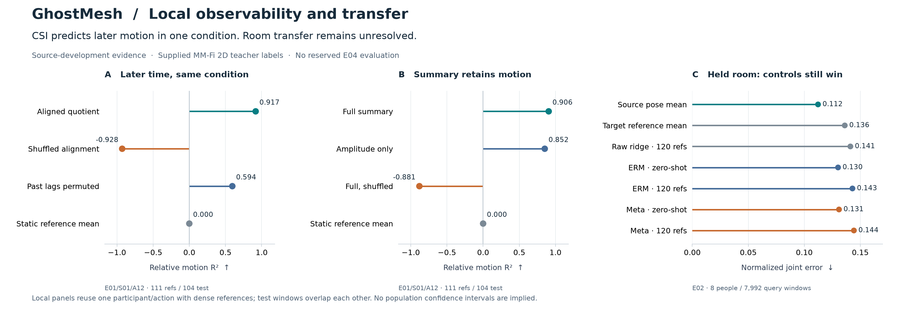
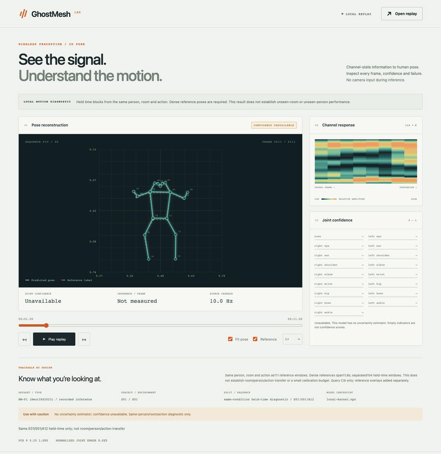

# CSI motion is learnable locally; transfer remains unresolved

On a fixed MM-Fi recording, a CSI-only model predicts later held-out motion:
**relative motion R² 0.9170, normalized joint error (NJE) 0.02466**, against
static-reference NJE 0.10354. Shuffling prediction/label alignment drops R² to
−0.9278. This provides a useful positive control for further model development.

**The result is limited to one person, room and action, with 111 dense labeled
reference windows over the first 11.8 seconds.** It does not establish unseen-room,
unseen-person or unseen-action pose recovery. A separate whole-action test fails,
and neither zero-shot nor 120-reference room adaptation beats the static source
prior in the E02 development screen. Released inference weights are unchanged.



[Exact plotted values and source hashes](assets/local-observability-v2/figure-data.json)
· [Editable SVG](assets/local-observability-v2/local-observability.svg)
· [Artifact hashes](assets/local-observability-v2/artifact-hashes.json)

## What the positive control establishes

The record is **E01/S01/A12**. The predeclared raw-frame blocks are training
`[0,118)`, validation `[126,178)` and test `[186,297)`, using zero-based,
half-open intervals. Eight raw frames are purged between blocks. Every prediction
uses eight causal frames wholly inside its block, producing **111/45/104**
training/validation/test windows. The first test endpoint is 7.6 seconds after
the last training endpoint. No raw input support crosses a split.

Inputs retain all 114 subcarriers and 10 packet columns. The audited magnitude
field is already logarithmic. One arm uses that magnitude divided by 20;
another uses interreceiver magnitude/phase quotients. No time, frame, action,
person or room identifier enters the predictor. Exact linear and radial-basis
function (RBF) kernel regressors use training-only normalization and bandwidth.
Each feature/kernel chooses its ridge regularization from
`[0.00001, 0.001, 0.1, 10]` using validation NJE alone.

| Held-time model/control | NJE ↓ | PCK@.05 ↑ | Relative motion R² ↑ |
|---|---:|---:|---:|
| Static reference mean | 0.10354 | 33.48% | 0.0000 |
| Raw-magnitude RBF | 0.03048 | 79.47% | 0.8855 |
| Quotient RBF | 0.02466 | 87.67% | 0.9170 |
| Quotient RBF, shuffled alignment | 0.13125 | 35.75% | −0.9278 |
| Quotient RBF, past lags permuted | 0.06455 | 53.05% | 0.5944 |
| Compressed full-summary RBF | 0.02708 | 84.22% | 0.9063 |
| Compressed amplitude-only RBF | 0.03528 | 72.79% | 0.8518 |

The compressed representation has 12 channels per subcarrier: receiver magnitude
means/standard deviations, plus circular means of interreceiver phase differences.
Its amplitude-only ablation zeros the six phase channels. Both reuse the exact
A12 split and validation procedure. The full summary retains substantial local
motion information, so a failed transfer model cannot be explained simply by
this summary removing all useful signal.

Output shuffle is equivalent to input-window permutation for these deterministic
models; those are one control, not independent evidence. The lag control keeps
the current frame and permutes seven past frames. It measures sensitivity to an
altered context; it does **not** prove an eight-frame model beats a separately
trained current-frame model.

## Where transfer fails

**Whole held action:** train complete E01/S01/A03 and A07, validate on A12,
test on complete A14, with 580/290/290 windows. The raw-magnitude RBF model
reaches NJE **0.06213**, worse than simply retaining the last training reference
pose (**0.04476**); relative motion R² is only **0.0029**. Quotient RBF is also
unsuccessful (NJE 0.05958, R² −0.0120). A12 is reused across these two development
protocols, so neither is an untouched final test.

**Held room E02:** train on 16 people in E01/E03 and select checkpoints on four
different source-room people. Ordinary supervised training (ERM) and learned
ridge adaptation use the same 84,252-parameter encoder, initialization, episode
schedule and 1,000 optimizer steps. The adaptation method is independently
implemented, with [differentiable ridge meta-learning precedent](https://arxiv.org/abs/1805.08136).
Each step processes 248 examples: ERM uses all 248 labels in its direct loss;
meta-learning uses 128 query labels in its outer loss and 120 reference labels
through the adaptation solve. These are different objectives, not identical
direct-loss label counts. Checkpoint selection averages zero-shot/adapted NJE
on source validation only. Both fits finish before held-room scoring.

Room calibration uses exactly **120 labels from S11/S12**, six specified actions
and ten endpoints per action. Query people are **S13–S20**, with all 27 actions.
The following results use the same **7,992 query windows** in both modes.
Calibration labels never come from these query people.

| E02 method | NJE ↓ | PCK@.05 ↑ | PCK@.2 ↑ | Relative motion R² ↑ |
|---|---:|---:|---:|---:|
| Source pose mean | **0.11225** | **26.88%** | **87.35%** | ≈0 |
| Target reference mean, 120 labels | 0.13613 | 12.36% | 82.85% | ≈0 |
| Raw ridge, same 120 labels | 0.14115 | 15.62% | 79.41% | −0.1101 |
| ERM, zero-shot | 0.13014 | 21.17% | 81.92% | −0.1491 |
| ERM, 120-label adaptation | 0.14299 | 13.69% | 79.66% | −0.2102 |
| Meta-trained, zero-shot | 0.13099 | 20.68% | 82.22% | −0.0706 |
| Meta-trained, 120-label adaptation | 0.14429 | 13.98% | 78.85% | −0.1118 |

Meta adaptation also loses to ERM adaptation on both calibration-represented and
other actions. Shuffling meta-adapted predictions slightly improves its NJE
(0.14401 versus aligned 0.14429). This recipe therefore does not support
time-specific reconstruction in the held room. E02 is a development room, not
the reserved final evaluation. No E04 result appears here.

## Metrics, verification and limits

NJE divides joint distance by each supplied teacher body's bounding-box diagonal.
PCK counts joints within the stated fraction of that same diagonal. Relative
motion R² removes the hip root, centers predicted and teacher articulation
independently within each recording **for scoring only**, then computes
`1 − error energy / teacher energy`. A static prediction gives R² zero; negative
values lose to the centered static control. Centering does not repair inference
outputs, so absolute NJE is reported separately. The labels are MM-Fi's supplied
model-generated 2D annotations, not independently measured physical motion.

All eight local and four compressed saved models reproduce their actual-RF
predictions exactly. Recomputed normal-equation residuals are at most
`7.72e-14` and `7.73e-15`, respectively. Raw supports, endpoint-label joins,
source hashes, training-only statistics and absence of exact cross-split RF-frame
duplicates were checked. Both ERM/meta zero-shot and adapted predictions replay
exactly from saved checkpoints. The underlying executed-source hashes and
result/registration/verification hashes are included with the figure data.

Training and test windows overlap **within** their respective blocks. Their
counts are not independent sample sizes, and no frame-independent significance
or population confidence interval is claimed. This diagnostic does not validate
small-reference calibration across arbitrary people/actions, hardware transfer,
uncertainty calibration, multi-person sensing or 3D reconstruction. Fit timings
are not inference latency/FPS measurements. The [broader research record](DOMAIN_RESEARCH.md)
and [frozen release study](../results/README.md) retain the unsuccessful trials.

## Reproduce

### Run the local-motion replay

The supplied replay contains the 104 held-time predictions from the compact
kernel checkpoint, plus separately attached teacher overlays. Its scope remains
the same person, room and action with 111 dense reference windows. This model
has **no uncertainty estimator**; the viewer displays confidence as unavailable.



*Thirty app captures at the source's nominal 10 Hz, without interpolated poses.
Teal is the CSI prediction; orange is the supplied teacher overlay.
[Desktop](assets/local-motion-v2/desktop.png),
[mobile](assets/local-motion-v2/mobile.png) and
[capture/source bindings](assets/local-motion-v2/capture.json) are retained.*

```sh
uv run ghostmesh serve --replay examples/local-motion-replay.json
```

To recompute predictions from the supplied CSI-only recording:

```sh
uv run python scripts/local_kernel_replay.py infer \
  --model models/local-kernel.npz --recording examples/local-csi.npz \
  --out work/local-recomputed.json
uv run ghostmesh serve --replay work/local-recomputed.json
```

All 104 poses reproduce the supplied replay within `1e-9`. The recomputed file
contains no teacher overlay or evaluation metrics. Generic recording inference
labels its source identity as unverified; model training identity does not
certify a new input recording's person or room. No raw-data download or hardware
is required for this path.

### Rebuild the figure and experiments

The figure can be rebuilt directly from its shipped compact data, without raw
data or hardware. Use the separate reporting environment described by
[`requirements-plots.txt`](../requirements-plots.txt):

```sh
uv venv .report-venv --python 3.12
uv pip install --python .report-venv/bin/python -r requirements-plots.txt
.report-venv/bin/python scripts/plot_local_observability.py \
  --data docs/assets/local-observability-v2/figure-data.json \
  --out work/observability-figure-reproduction
```

Real-data experiments require the verified, licensed source30 typed cache at
`work/domain-source30-rf-v1`, containing `rf.npy`, `pose.npy`, `valid.npy` and its
receipt. It is built by `scripts/domain_full_source_cache.py` using
[`configs/domain-v2-source30.json`](../configs/domain-v2-source30.json), following
the [data-access and consent requirements](DATA_ACCESS.md). The exact cache
receipt SHA256 is `52fc6f641277926736daf79ccb87b122e0ae7a7f0fc9e587f567946dec41cd8f`.
This cache is a prerequisite, not a bundled data download.

In the locked ML environment, use fresh output directories:

```sh
python scripts/domain_same_condition_probe.py \
  --cache work/domain-source30-rf-v1 --out work/local-reproduction
python scripts/verify_same_condition_probe.py \
  --cache work/domain-source30-rf-v1 --out work/local-reproduction
python scripts/seal_research_artifacts.py --root work/local-reproduction
python scripts/domain_observation_cache.py \
  --source work/domain-source30-rf-v1 --out work/observations-reproduction
python scripts/domain_observation_positive_probe.py \
  --cache work/domain-source30-rf-v1 --predecessor work/local-reproduction \
  --out work/summary-reproduction
python scripts/verify_observation_positive_probe.py \
  --cache work/domain-source30-rf-v1 --frame-cache work/observations-reproduction \
  --out work/summary-reproduction
python scripts/domain_meta_probe.py \
  --cache work/observations-reproduction --base work/domain-source30-rf-v1 \
  --device cpu --out work/meta-reproduction
```

The historical fit used local Apple MPS; `--device mps` selects that backend
where supported. CPU and MPS retraining need not be bit-exact. To bind the
original completed JSONs and rebuild this figure, use
`python scripts/plot_local_observability.py --experiments work --out work/observability-original`.
That extraction intentionally refuses changed historical evidence; a new fit
needs its own report and source bindings. MM-Fi data and derived assets retain
[CC BY-NC 4.0 and author attribution](../data/LICENSE.md).

The sealing command records file-byte hashes after verification. Its manifest
is a reproducibility aid, not scientific certification or an immutability guarantee.

## Measured diagnostic latency

The compact kernel's batch-one CPU path includes RF preprocessing and regression,
with the reference checkpoint already loaded. Thirty measured calls after five
warmups had median wall latency **315.6 ms**, or **3.17 predictions/second**;
median process CPU time was 13.77 ms. Concurrent local work and scheduling affect
wall time. This measurement does not establish 10 Hz live inference. Saved replay
plays at the dataset's nominal 10 Hz. It excludes acquisition, file I/O and
rendering and is not comparable to the older neural forward-only benchmark.
[All timing samples and identities](assets/local-motion-v2/latency.json).

```sh
OPENBLAS_NUM_THREADS=1 OMP_NUM_THREADS=1 VECLIB_MAXIMUM_THREADS=1 \
  python scripts/benchmark_local_kernel.py --out work/local-kernel-latency.json
```
