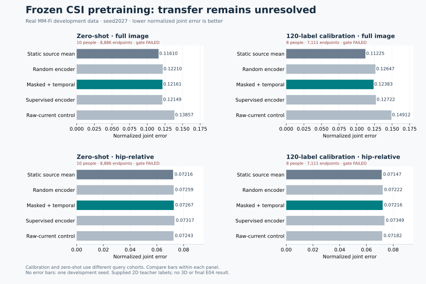

# Masked CSI representations and a different movement decoder

**Incomplete: neither zero-shot nor 120-label room calibration solves transfer.**
These are actual MM-Fi development experiments, not fabricated demonstration
scores. An independent post-score audit reconstructed **89 prediction sets**
and found **zero metric disagreements**. All four original efficacy gates fail.
The released inference models have not been replaced with these candidates.



The [machine-readable report](domain-v2-masked-results.json) retains all controls,
PCK curves, per-person/action results, global per-joint errors, failed gates,
source-only grids and provenance hashes. NJE is joint error divided by each
provided body's bounding-box diagonal; lower is better. Motion R² removes each
recording's constant pose for evaluation only. Zero is the static reference.
Predictions never receive a query skeleton, its hips or its temporal mean.

## What was trained

Sixteen people in E01/E03 supply 14,124 training endpoints, four different
people supply 3,546 validation endpoints, and E02 supplies 8,886 development
query endpoints from ten people. All 27 actions are included. Complete people
and recordings remain together. Each endpoint retains an eight-frame causal
history and the existing forty-frame signal-quality guard. The 174 allocated
but unused rows at the end of the covariance cache are excluded.

An independently implemented patch encoder processes three receivers, 114
subcarriers and ten packet columns. Its 95 ordered tokens each contain 36
measurements. Two 48-dimensional attention layers produce frame features;
eight frame embeddings form a 512-dimensional history. The encoder has 53,744
parameters. This is a bounded pilot, not a reproduction of another paper's
training budget or benchmarks.

Four learned arms use the same initialization, 4,000 optimizer steps, batches
of sixteen histories, raw-data schedule and mask sequence:

| Arm | Representation objective |
|---|---|
| Masked only | Reconstruct exactly 71 masked tokens per frame |
| Masked + temporal, primary | Reconstruction plus adjacent alignment, variance and covariance penalties |
| Shuffled pretext | Same objective, with adjacent partners replaced within each history |
| Supervised | Endpoint pose supervision using the same raw histories and optimizer budget |

A fifth encoder stays randomly initialized. Every frozen encoder subsequently
receives the same 14,124 training labels through a 512-feature nonlinear ridge
readout. Source validation chooses its regularization. A raw-current covariance
control and the earlier temporal control remain visible.

Final encoders are fixed before pose-readout validation. Training consumes
512,000 frame occurrences per learned arm; only the supervised encoder consumes
64,000 endpoint label occurrences during encoder optimization. Pretraining is
not an equal-label-budget comparison by itself; the subsequent readout budget
is matched. Total fitting and feature/readout extraction took 58.71 minutes on
the local MPS device. This is training time, not deployed latency or FPS.

The [versioned recipe](../configs/masked-csi-e02-pilot-v1.json) records the actual
constants. Raw magnitude is receiver-relative log magnitude, not calibrated
RSSI. Finite-only normalization occurs independently within each frame. Missing
cells are excluded from reconstruction targets. Masked raw values contribute
two frame mean/standard-deviation statistics before masking, so strict
independence from masked raw targets is **not** claimed. No pose, future-frame
or cross-record statistics enter that transform.

## Four separately frozen comparisons

| Protocol | Query cohort | Primary NJE | Matched static NJE | Primary motion R² | Gate |
|---|---|---:|---:|---:|---|
| Zero-shot, hip-relative | 10 people, 8,886 endpoints | .072669 | .072157 | −.002220 body | Fail |
| Zero-shot, full image | 10 people, 8,886 endpoints | .121607 | .116099 | −.038966 full | Fail |
| Calibrated, hip-relative | 8 different people, 7,111 endpoints | .072157 | .071465 | −.002392 body | Fail |
| Calibrated, full image | 8 different people, 7,111 endpoints | .123827 | .112252 | −.041109 full | Fail |

Compare controls **within a row**. The zero-shot and calibrated rows use
different people. The calibrated full-image primary also worsens against its
own matched zero-shot result, .118245. The supervised full-image control beats
the primary zero-shot model slightly, .121489 versus .121607. Tiny improvements
over a neural control do not establish useful sensing when a static mean wins.

The full-image heads learn hip location from source training labels and select
regularization/shrinkage on source validation. Hip-relative predictions are
not placed using query hips. Body, root and full-image movement are reported
separately. Nothing here establishes 3D reconstruction or camera calibration.

Calibration uses **120 labeled endpoint windows**: S11/S12, actions A03/A07/A12,
twenty windows per recording. S13–S20 are query people. Two reference-person
cross-validation folds choose kernel regularization and correction strength;
each fold's normalization and bandwidth use only its sixty fitting references.
All arms and controls receive the same reference labels. The primary body
correction selects strength zero. The full-image correction selects .5 but
harms query error. Two reference people and three actions are a limited basis
for calibration selection, not a validated product enrollment procedure.

All source heads, calibration choices and four numerical audits were sealed
before any new query score. The [original evaluation ledger](masked-evaluation-freeze.json)
pins those eight identities. The post-score verifier independently reconstructs
source readouts, hip heads, reference kernels and priors, then recomputes PCK,
NJE, motion, shuffle controls, subgroup reversals and gates. The older temporal
baseline is a hash-bound saved prediction snapshot; its old encoder is not
rerun by that audit. Numerical agreement confirms the failed measurements,
not efficacy.

## What the failure changed

A separate S04/A12 dense personal-calibration test checks whether the frozen
features retain local motion. S04 never entered encoder optimization. Earlier
111 labeled windows fit a fresh local head, 45 later windows select it and 104
purged held-time windows evaluate it. The primary achieves body R² **.6745**
and NJE **.03407**, but raw quotient features perform better, **.7431/.03223**.
The shuffled-pretext encoder also beats the primary. Fresh CSI-only inference
reproduces all fourteen local readouts within 5.83e-15 without opening query
annotations. This establishes a narrow local information result after dense
same-person/room/action calibration, not room transfer or a benefit from
adjacent self-supervision.

The next decoder explicitly conditions the mapping from CSI changes to pose
changes on the current channel state. It is odd under endpoint reversal and
predicts zero for an unchanged signal. Source-only TRAIN statistics, context
principal components and ridge fitting support natural versus shuffled-context
controls. All 126 configurations remain reported. Its source-selected primary
has equal-room displacement R² **.000570**, below the preset .05 feasibility
threshold. It was not advanced to E02.

A separate follow-up averages each causal eight-frame embedding history before
the same decoder. It improves equal-room displacement R² to **.008551**
(pooled .009007), positive for all four source-validation people, but still
misses the original threshold. Labels remain at the endpoint: this smoothing
has a nominal .35-second center delay and is not a label-shift correction.
Both screens test source feasibility, not complete-pose inference. A learned
displacement field also needs an initial-pose solution and drift validation.

The completed spatial-token follow-up keeps the encoder's 95 patch features
available to joint-specific queries, instead of using only their global
average. Four matched heads each train for 2,000 steps on the same 32-pair
source schedule, with identical initial parameters and frozen encoders. Its
pose potential predicts its own initial skeleton; it receives no query
initial pose. Every arm fails the source feasibility screen:

| Source-validation head | Hip-relative NJE | Body motion R² | Lag-eight displacement R² |
|---|---:|---:|---:|
| Masked spatial + motion, primary | .068964 | −.033000 | −.012239 |
| Masked global + motion | .068836 | −.030764 | −.013849 |
| Random spatial + motion | .066936 | −.010964 | −.003269 |
| Masked spatial + absolute only | .071000 | −.094461 | −.067273 |

Fresh CPU inference reproduces all four sets of 3,546 source-validation
predictions within 7.27e-8 of MPS. Independently coded metrics agree within
2e-12; source label joins, initializations and all 64,000 causal training pairs
also check. This inference readback shares the model class, while the metric
calculation is separate. These outcomes do not support patch preservation or
the masked representation as a sufficient transfer fix. No E02 score was run
for this follow-up.

## Reproduce and inspect

Install the locked environment with `uv sync --locked --extra test`. Build and
verify the source30 raw/covariance caches and original covariance baseline as
described in [DOMAIN_RESEARCH.md](DOMAIN_RESEARCH.md) and
[COVARIANCE_RESEARCH.md](COVARIANCE_RESEARCH.md). All fit outputs must be fresh.
Keep each study in a separate checkout when regenerating its frozen paths.
Data acquisition, original study receipts and metric rendering are distinct
operations. The repository does not bundle the large experimental token caches
or claim that replotting a JSON file reruns the experiment.

Once those prerequisites exist in a **fresh checkout**, the complete pilot has
one entry point. Preview its fourteen stages, then run the same plan:

```sh
uv run python scripts/run_masked_study.py --dry-run
uv run python scripts/run_masked_study.py --device cpu
```

It fits all four protocols, runs each numerical audit, freezes a new ledger,
scores each mode and independently audits the completed results. Hash arguments
come from that run's actual artifacts. It refuses existing experiments and
stops on the first failed stage. `--fit-only` stops after the pre-score freeze
for inspection. It acquires no data and publishes nothing. For an interrupted
run, preserve its receipt and artifacts and use the individual stage commands;
the runner does not silently restart or overwrite partial studies.

The individual source fitting and audit stages are also directly callable:

```sh
uv run python scripts/domain_masked_pretrain_probe.py \
  --raw work/domain-source30-rf-v1 --cache work/domain-covariance-full-cache-v1 \
  --old-probe work/domain-covariance-full27-v1 \
  --out work/domain-masked-pretrain-e02-v1 --device cpu
uv run python scripts/verify_masked_pretrain_probe.py \
  --experiment work/domain-masked-pretrain-e02-v1 \
  --raw work/domain-source30-rf-v1 --cache work/domain-covariance-full-cache-v1 \
  --old-probe work/domain-covariance-full27-v1 \
  --output work/domain-masked-source-verification-v1.json
```

The trainer stops before query scores. `--device mps` uses an available local
Apple GPU; CPU and GPU runs need not produce byte-identical checkpoints.
`--resume` accepts sealed training recovery checkpoints with matching identities.
Never start a second writer in the same study directory.

Use the emitted source-ready hash with
`domain_masked_fullpose_probe.py` to fit source-only root heads. Fit both
`domain_masked_calibration_probe.py fit` and
`domain_masked_fullimage_calibration_probe.py fit` **before scoring any mode**.
Their `--help` contracts expose required source, cache, raw, output and readiness
hash arguments. Independently verify those fits with
`verify_masked_fullpose_probe.py` and `verify_masked_calibration_probe.py`
(`--mode body` and `--mode full`). Preserve the four audit outputs at the paths
shown in the original ledger. Then seal the new run:

```sh
uv run python scripts/freeze_masked_evaluation.py \
  --output work/domain-masked-e02-evaluation-freeze-v1.json
```

This refuses partial or completed query scoring and binds all four fitted
states and all four audits. Record the printed SHA before invoking the four
explicit score modes. The hip-relative source scorer uses `--score-frozen-out`;
the full-image scorer uses `--score-frozen-sha256`; the calibration scripts use
their `score` positional mode. Preserve all failed gates. After all four finish:

```sh
uv run python scripts/verify_masked_results.py \
  --ledger-sha256 "$(uv run python -c 'import hashlib; from pathlib import Path; print(hashlib.sha256(Path("work/domain-masked-e02-evaluation-freeze-v1.json").read_bytes()).hexdigest())')" \
  --output work/independent-post-score-audit.json
```

The ledger must be the one emitted before scoring that new run, not the
historical run's ledger. The source-motion and conditioned screens are
currently exact-input diagnostics bound to the published historical
source-ready identity. They intentionally refuse a newly trained encoder with
different bytes. Adapting them to a new experiment requires a separate,
prospectively recorded recipe and explicit input hash.

To render the published measured summary without training, install
`requirements-plots.txt` in a separate plotting environment and run:

```sh
python scripts/plot_masked_study.py --out work/masked-figure-reproduction
```

All scientific source data, supplied teacher labels and derived figures retain
MM-Fi's [noncommercial attribution terms](../data/LICENSE.md). No RGB was
downloaded or used. E02 has prior development exposure, room and person shifts
are confounded, and this single seed is not final confirmation. E04 remains
reserved under the existing protected protocol. Hardware capture and ESP32
model transfer remain separately unvalidated.
