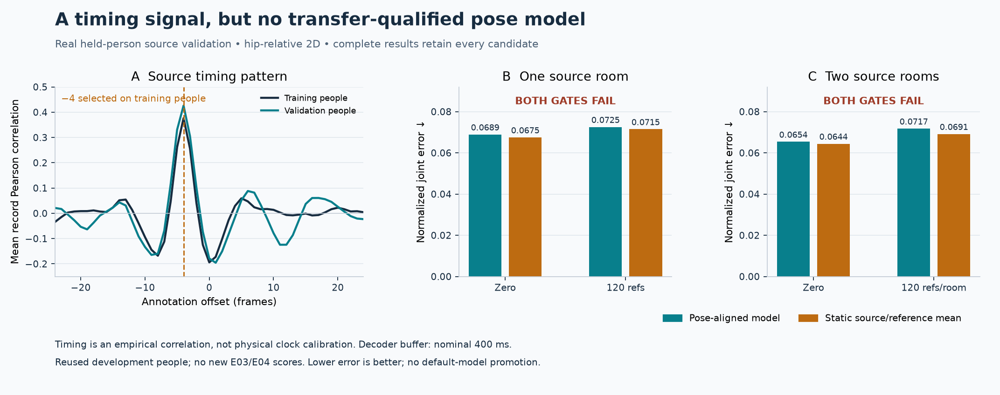

# Signal timing and pose-prototype transfer

**Neither candidate passes its source gate.** A reproducible RF/annotation timing
pattern motivated a delayed temporal decoder. Direct pose-similarity supervision
across people, then across two source rooms with denser training, did not produce
useful consistent motion recovery. The default application models are unchanged.
[Complete candidates, frozen recipes, metrics and audits](domain-v2-timing-transfer-results.json).

## What the timing test establishes

The diagnostic compares changes in receiver log magnitude or inter-receiver
log/circular CSI features with changes in supplied hip-relative 2D annotations.
It uses matched window widths 1/4/8/16/32 and all integer annotation offsets
−24 through +24. A common forty-frame RF quality guard is applied for every
comparison. Each record contributes a Pearson correlation; accepted finite
record correlations are averaged within each split. Eight E01 people select the lag;
S04/S09 report source validation. They have prior project development exposure.

All ten training curves select annotation offset **−4 frames**. For the
inter-receiver width-four trace, mean training correlation is **0.376429** and
source-validation correlation **0.426051**, versus **−0.178827** at zero offset.
The public diagnostic exactly reproduces all **980** preceding fine-sweep
aggregate values and all ten selections. It also reports autocorrelations using
pairs at their original frame indices, without compressing missing-frame gaps.
Circular shifts are descriptive controls, not independent trials or p-values.

This is an empirical alignment pattern, **not physical clock calibration**.
Periodic movements produce ambiguous per-record peaks. The supplied 10 Hz frame
rate makes the corresponding four-frame decoder buffer nominally **400 ms**;
preprocessing, acquisition and rendering add time. A subsequent TRAIN-only
comparison of E01 and E02 selected the same offset in both rooms for all ten
curves. Different room offsets therefore do not explain the observed E02 failure.

## Learned representation and controls

Both studies retain all 114 subcarriers. Thirty-two frames of packet mean and
standard deviation enter a temporal convolutional encoder, with both source
training normalization and per-history centering/RMS scaling. The decoder ends
at target frame +4. A common RF guard covers target −39 through +4. No query
pose, hip, root, activity label or teacher-derived record mean enters inference.
Teacher bounding boxes are used only to normalize evaluation error.

The model predicts a weighted combination of 128 source-training pose
prototypes. Centroids, prior weights and all normalization statistics come only
from training people. The initial head reproduces the training pose prior.
A continuous similarity loss asks RF codes to preserve teacher-pose similarity
between different training people or rooms. This is an independent application
of established [similarity-preserving distillation](https://openaccess.thecvf.com/content_ICCV_2019/html/Tung_Similarity-Preserving_Knowledge_Distillation_ICCV_2019_paper.html)
and [supervised contrastive learning](https://arxiv.org/abs/2004.11362) ideas,
not a new general learning principle. Identity/room labels constrain training
pairs only; model inference consumes RF alone.

Each study compares ordinary supervised learning, the pose-aligned candidate
and an intentionally mismatched teacher. All arms share initialization, labels,
RF schedule, architecture and update budget. All three training budgets finish
before any candidate validation scores are computed. Every 0/500/…/3000-step
checkpoint is retained. Zero-shot and calibration separately select highest
source-validation body-motion R², then lower error and earlier step.

| Study | Source train / validation | RF endpoints per arm | Reference budget |
|---|---|---:|---|
| Cross-person, E01 | 8 / 2 whole people; 6,830 / 1,719 windows | 72,000 | 120 from S01/S02, A03/A07/A12 |
| Cross-room, E01/E02 | 16 / 4 whole people; 108,956 / 3,435 windows | 96,000 | 120 per room, 240 total |

The dense study trains on every eligible endpoint; validation remains at stride
eight. Context windows cannot cross people or recording boundaries. Both source
rooms are represented during training, so these are **source feasibility**
studies, not unseen-room results. E03 is unused by these fits but historically
exposed elsewhere in the project. The protected E04 experiment stays unscored.

Calibration learns a residual ridge map on unit 128-dimensional RF codes using
the stated references. Different people provide the queries. In the dense study
each room gets its own reference map, and the known calibration profile selects
the map. This is not a room-ID input to the encoder. Raw RF linear/RBF controls
receive the same references and context, with regularization selected using
reference-person cross-validation. They use fewer global labels than the neural
models and are additional reference-only controls, not equal-training-budget
neural comparisons. Static, source-time and diagnostic oracle-room priors are
also retained.

## Actual held-person source results

These are hip-relative 2D body metrics, not full position or 3D. PCK is the
fraction of joints within the threshold times the teacher bounding-box diagonal;
NJE is mean distance divided by that diagonal. Motion R² centers prediction and
teacher trajectories inside each record **for evaluation only**. A static output
has zero motion R²; a low NJE alone can favor an average pose.

| Study / mode | Primary NJE ↓ | Strong control NJE ↓ | Body motion R² ↑ | Outcome |
|---|---:|---:|---:|---|
| E01 cross-person, zero | 0.068896 | 0.067482, source mean | 0.017963 | Fail |
| E01 cross-person, 120 refs | 0.072524 | 0.071452, reference mean | −0.065276 | Fail |
| E01/E02 cross-room, zero | 0.065364 | 0.064408, source mean | 0.002544 | Fail |
| E01/E02 cross-room, 120 refs/room | 0.071743 | 0.069126, reference mean | −0.049293 | Fail |

The cross-room candidate's source body-motion R² is **0.021023 in E01** and
**−0.019061 in E02**. Its ordinary and wrong-teacher zero-shot controls select
step zero. The one-room wrong-teacher arm has higher body-motion R² than its
correctly aligned arm. These reversals argue against attributing a reliable
benefit to the proposed teacher objective.

Both gates require useful body/difference motion, improvements over controls,
non-worse PCK and a worse shuffled-signal control. The dense gate also requires
both source rooms to improve and at least three of four validation people to
have positive motion R². Calibration must beat its own best zero-shot model
and the zero-shot output of its selected calibration checkpoint. The full JSON
retains each failed condition, every checkpoint, all PCK thresholds and all
available person/action/room breakdowns.



## Verification and reproduction

Independent auditors reconstruct all raw frame/target joins, training-only
statistics and prototypes, accepted validation/reference RF histories, selected
CPU predictions, every candidate reference equation, raw reference CV and
kernel equations, metrics, selections and both gates. They share the actual
model classes and guarded loaders; RF equations, reductions, solves and metric
checks are independent of the producers. The one-room audit checks **8,549**
joins and **21** states; the dense audit checks **112,391** joins and **21**
states with **42** per-room reference equations. Maximum metric disagreements
are below **10⁻¹⁵**. Audits validate failed measurements, not useful sensing.

After [authorized MM-Fi acquisition](DATA_ACCESS.md) and construction of the
[typed source RF cache](DOMAIN_RESEARCH.md), use fresh output directories:

```bash
uv sync --locked --extra test
uv run python scripts/build_delayed_moment_cache.py \
  --raw work/domain-source30-rf-v1 --out work/source10-delayed
uv run python scripts/diagnose_source_alignment.py \
  --raw work/domain-source30-rf-v1 --quality-cache work/source10-delayed \
  --out work/alignment-diagnostic
uv run python scripts/domain_pose_alignment_probe.py \
  --cache work/source10-delayed --raw work/domain-source30-rf-v1 \
  --config configs/pose-alignment-e03-v1.json --out work/pose-probe --device cpu
uv run python scripts/verify_pose_alignment_source.py \
  --study work/pose-probe --cache work/source10-delayed \
  --raw work/domain-source30-rf-v1 --out work/pose-audit.json
uv run python scripts/build_dense_source_cache.py \
  --raw work/domain-source30-rf-v1 --out work/source20-dense \
  --plan configs/cross-room-dense-e03-v1.json
uv run python scripts/compare_source_room_alignment.py \
  --raw work/domain-source30-rf-v1 --cache work/source20-dense \
  --out work/source-room-timing
uv run python scripts/domain_dense_room_probe.py \
  --cache work/source20-dense --raw work/domain-source30-rf-v1 \
  --config configs/cross-room-dense-e03-v1.json --out work/dense-probe --device cpu
uv run python scripts/verify_dense_room_source.py \
  --study work/dense-probe --cache work/source20-dense \
  --raw work/domain-source30-rf-v1 --out work/dense-audit.json
```

The original fits used MPS, Python 3.12, NumPy 2.2.6, SciPy 1.16.3 and Torch
2.9.0. CPU training is supported but cross-backend optimization need not produce
identical weights or scores. Both auditors use CPU. Source/config/cache changes
are rejected on checkpoint recovery; `--resume` requires the same recipe and
backend after the previous writer exits. The public dense-cache command is a
parameterized version of the archived producer; a fresh real-data build is
checked against the actual study cache.

No candidate qualifies for a new-room score, five-seed final claim or model
promotion. No inference latency/FPS benchmark is claimed for these prototypes;
training duration is not latency. For the runnable application, use the
[existing replay path](REPRODUCE.md). Data are consented research recordings
under MM-Fi's noncommercial terms, and no camera is needed during inference.
