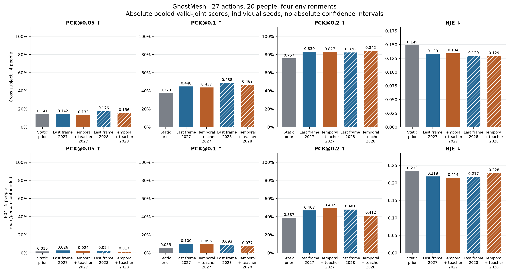
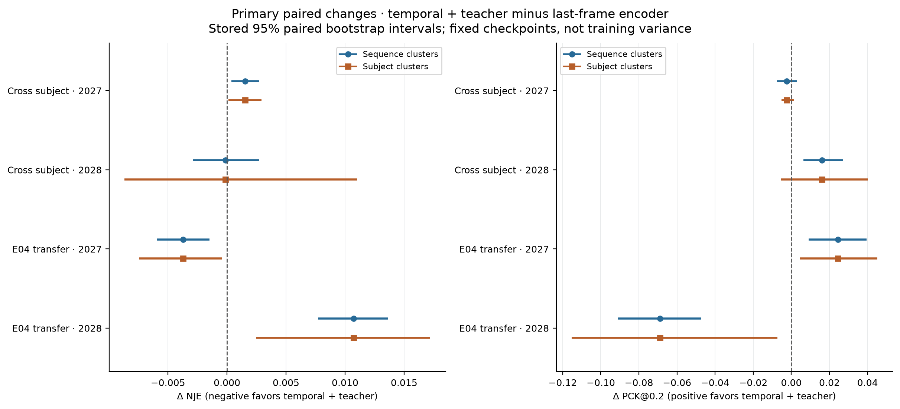
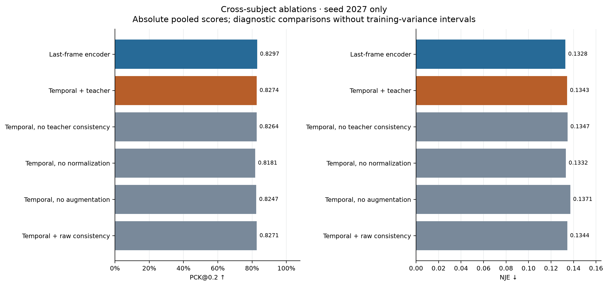

# GhostMesh: measured cohort20 results

A bounded MM-Fi dataset experiment covering **27 actions, 20 people and four environments**. All evaluated actions occur in training. These scores describe 2D annotation prediction on this cohort; they do not establish full-dataset, 3D, unseen-action or cross-dataset performance.

## Protocol and interpretation

- Cross subject: four held-out people; environments remain represented in training.
- Cross environment: E04 with five people. Room and person changes are confounded, so this is a joint room/person transfer test.
- Static prior: training-label mean pose with no CSI input. Last-frame encoder: the same eight-frame causal-window preprocessing and normalization used by the temporal model, then last-frame encoding.
- Temporal + teacher combines temporal encoding and source-only teacher consistency. Primary pairs use seeds 2027 and 2028 in both protocols. Ablations use seed 2027 only.
- PCK is the fraction of valid joints within the named fraction of each frame’s valid ground-truth 2D bounding-box diagonal. NJE is mean joint Euclidean error divided by that diagonal; it is not millimeters.
- Absolute scores below are pooled valid-joint metrics. Paired changes instead give equal weight to sequence means. Their values need not equal differences of pooled scores.

## Absolute test scores

No absolute-score confidence intervals are inferred from paired-difference intervals. PCK figure axes start at zero.

| Protocol | Method | Seed | PCK@.05 | PCK@.1 | PCK@.2 | NJE ↓ |
|---|---|---:|---:|---:|---:|---:|
| cross_subject | Static training mean pose | N/A | 0.1411 | 0.3726 | 0.7568 | 0.1487 |
| cross_subject | Last-frame encoder | 2027 | 0.1425 | 0.4481 | 0.8297 | 0.1328 |
| cross_subject | Temporal + teacher | 2027 | 0.1320 | 0.4371 | 0.8274 | 0.1343 |
| cross_subject | Temporal, no teacher consistency | 2027 | 0.1311 | 0.4334 | 0.8264 | 0.1347 |
| cross_subject | Temporal, no normalization | 2027 | 0.1649 | 0.4504 | 0.8181 | 0.1332 |
| cross_subject | Temporal, no augmentation | 2027 | 0.1154 | 0.4177 | 0.8247 | 0.1371 |
| cross_subject | Temporal + raw consistency | 2027 | 0.1318 | 0.4356 | 0.8271 | 0.1344 |
| cross_subject | Last-frame encoder | 2028 | 0.1765 | 0.4877 | 0.8255 | 0.1293 |
| cross_subject | Temporal + teacher | 2028 | 0.1560 | 0.4678 | 0.8416 | 0.1292 |
| cross_environment | Static training mean pose | N/A | 0.0146 | 0.0552 | 0.3870 | 0.2333 |
| cross_environment | Last-frame encoder | 2027 | 0.0263 | 0.0997 | 0.4677 | 0.2181 |
| cross_environment | Temporal + teacher | 2027 | 0.0236 | 0.0950 | 0.4922 | 0.2144 |
| cross_environment | Last-frame encoder | 2028 | 0.0240 | 0.0928 | 0.4811 | 0.2174 |
| cross_environment | Temporal + teacher | 2028 | 0.0170 | 0.0766 | 0.4122 | 0.2281 |

## Paired changes and sampling uncertainty

Candidate minus reference; negative NJE and positive PCK@.2 favor the candidate. Intervals are the suite’s existing paired percentile bootstrap 95% intervals. Sequence blocks and subject-cluster sensitivity describe held-out sampling for fixed checkpoints, not training-seed variability. Only two training seeds are available; small numbers of held-out people make subject intervals unstable.

| Protocol | Candidate minus reference | Metric | Cluster (N) | Delta | 95% interval |
|---|---|---|---|---:|---|
| cross_subject | cohort20-temporal minus cohort20-baseline | normalized_joint_error | sequence (108) | 0.0015 | [0.0004, 0.0027] |
| cross_subject | cohort20-temporal minus cohort20-baseline | pck | sequence (108) | -0.0024 | [-0.0075, 0.0030] |
| cross_subject | cohort20-temporal minus cohort20-baseline | normalized_joint_error | subject (4) | 0.0015 | [0.0001, 0.0029] |
| cross_subject | cohort20-temporal minus cohort20-baseline | pck | subject (4) | -0.0024 | [-0.0051, 0.0012] |
| cross_subject | cohort20-no_consistency minus cohort20-baseline | normalized_joint_error | sequence (108) | 0.0019 | [0.0008, 0.0031] |
| cross_subject | cohort20-no_consistency minus cohort20-baseline | pck | sequence (108) | -0.0034 | [-0.0086, 0.0021] |
| cross_subject | cohort20-no_consistency minus cohort20-baseline | normalized_joint_error | subject (4) | 0.0019 | [0.0005, 0.0033] |
| cross_subject | cohort20-no_consistency minus cohort20-baseline | pck | subject (4) | -0.0034 | [-0.0059, 0.0006] |
| cross_subject | cohort20-temporal-seed2028 minus cohort20-baseline-seed2028 | normalized_joint_error | sequence (108) | -0.0001 | [-0.0029, 0.0027] |
| cross_subject | cohort20-temporal-seed2028 minus cohort20-baseline-seed2028 | pck | sequence (108) | 0.0161 | [0.0063, 0.0270] |
| cross_subject | cohort20-temporal-seed2028 minus cohort20-baseline-seed2028 | normalized_joint_error | subject (4) | -0.0001 | [-0.0087, 0.0110] |
| cross_subject | cohort20-temporal-seed2028 minus cohort20-baseline-seed2028 | pck | subject (4) | 0.0161 | [-0.0055, 0.0400] |
| cross_subject | cohort20-temporal minus cohort20-no_consistency | normalized_joint_error | sequence (108) | -0.0004 | [-0.0005, -0.0003] |
| cross_subject | cohort20-temporal minus cohort20-no_consistency | pck | sequence (108) | 0.0010 | [0.0005, 0.0015] |
| cross_subject | cohort20-temporal minus cohort20-no_consistency | normalized_joint_error | subject (4) | -0.0004 | [-0.0005, -0.0003] |
| cross_subject | cohort20-temporal minus cohort20-no_consistency | pck | subject (4) | 0.0010 | [0.0001, 0.0019] |
| cross_subject | cohort20-temporal minus cohort20-no_normalization | normalized_joint_error | sequence (108) | 0.0011 | [-0.0027, 0.0050] |
| cross_subject | cohort20-temporal minus cohort20-no_normalization | pck | sequence (108) | 0.0093 | [-0.0025, 0.0220] |
| cross_subject | cohort20-temporal minus cohort20-no_normalization | normalized_joint_error | subject (4) | 0.0011 | [-0.0099, 0.0127] |
| cross_subject | cohort20-temporal minus cohort20-no_normalization | pck | subject (4) | 0.0093 | [-0.0100, 0.0203] |
| cross_subject | cohort20-temporal minus cohort20-no_augmentation | normalized_joint_error | sequence (108) | -0.0028 | [-0.0037, -0.0018] |
| cross_subject | cohort20-temporal minus cohort20-no_augmentation | pck | sequence (108) | 0.0027 | [-0.0018, 0.0068] |
| cross_subject | cohort20-temporal minus cohort20-no_augmentation | normalized_joint_error | subject (4) | -0.0028 | [-0.0064, 0.0008] |
| cross_subject | cohort20-temporal minus cohort20-no_augmentation | pck | subject (4) | 0.0027 | [-0.0070, 0.0124] |
| cross_environment | cohort20-environment-temporal minus cohort20-environment-baseline | normalized_joint_error | sequence (135) | -0.0037 | [-0.0060, -0.0015] |
| cross_environment | cohort20-environment-temporal minus cohort20-environment-baseline | pck | sequence (135) | 0.0245 | [0.0090, 0.0394] |
| cross_environment | cohort20-environment-temporal minus cohort20-environment-baseline | normalized_joint_error | subject (5) | -0.0037 | [-0.0075, -0.0004] |
| cross_environment | cohort20-environment-temporal minus cohort20-environment-baseline | pck | subject (5) | 0.0245 | [0.0045, 0.0452] |
| cross_subject | cohort20-temporal minus cohort20-raw_consistency | normalized_joint_error | sequence (108) | -0.0001 | [-0.0002, -0.0001] |
| cross_subject | cohort20-temporal minus cohort20-raw_consistency | pck | sequence (108) | 0.0003 | [0.0001, 0.0005] |
| cross_subject | cohort20-temporal minus cohort20-raw_consistency | normalized_joint_error | subject (4) | -0.0001 | [-0.0002, -0.0000] |
| cross_subject | cohort20-temporal minus cohort20-raw_consistency | pck | subject (4) | 0.0003 | [-0.0001, 0.0007] |
| cross_environment | cohort20-environment-temporal-seed2028 minus cohort20-environment-baseline-seed2028 | normalized_joint_error | sequence (135) | 0.0107 | [0.0077, 0.0136] |
| cross_environment | cohort20-environment-temporal-seed2028 minus cohort20-environment-baseline-seed2028 | pck | sequence (135) | -0.0689 | [-0.0908, -0.0472] |
| cross_environment | cohort20-environment-temporal-seed2028 minus cohort20-environment-baseline-seed2028 | normalized_joint_error | subject (5) | 0.0107 | [0.0025, 0.0172] |
| cross_environment | cohort20-environment-temporal-seed2028 minus cohort20-environment-baseline-seed2028 | pck | subject (5) | -0.0689 | [-0.1154, -0.0073] |
| cross_subject | cohort20-baseline minus train-mean-pose-no-signal | normalized_joint_error | sequence (108) | -0.0160 | [-0.0237, -0.0085] |
| cross_subject | cohort20-baseline minus train-mean-pose-no-signal | pck | sequence (108) | 0.0729 | [0.0402, 0.1078] |
| cross_subject | cohort20-baseline minus train-mean-pose-no-signal | normalized_joint_error | subject (4) | -0.0160 | [-0.0503, 0.0126] |
| cross_subject | cohort20-baseline minus train-mean-pose-no-signal | pck | subject (4) | 0.0729 | [-0.0151, 0.2182] |
| cross_subject | cohort20-temporal minus train-mean-pose-no-signal | normalized_joint_error | sequence (108) | -0.0145 | [-0.0218, -0.0073] |
| cross_subject | cohort20-temporal minus train-mean-pose-no-signal | pck | sequence (108) | 0.0706 | [0.0379, 0.1059] |
| cross_subject | cohort20-temporal minus train-mean-pose-no-signal | normalized_joint_error | subject (4) | -0.0145 | [-0.0481, 0.0134] |
| cross_subject | cohort20-temporal minus train-mean-pose-no-signal | pck | subject (4) | 0.0706 | [-0.0188, 0.2164] |
| cross_environment | cohort20-environment-baseline minus train-mean-pose-no-signal | normalized_joint_error | sequence (135) | -0.0152 | [-0.0203, -0.0102] |
| cross_environment | cohort20-environment-baseline minus train-mean-pose-no-signal | pck | sequence (135) | 0.0807 | [0.0455, 0.1165] |
| cross_environment | cohort20-environment-baseline minus train-mean-pose-no-signal | normalized_joint_error | subject (5) | -0.0152 | [-0.0298, -0.0050] |
| cross_environment | cohort20-environment-baseline minus train-mean-pose-no-signal | pck | subject (5) | 0.0807 | [-0.0158, 0.1925] |
| cross_environment | cohort20-environment-temporal minus train-mean-pose-no-signal | normalized_joint_error | sequence (135) | -0.0189 | [-0.0247, -0.0135] |
| cross_environment | cohort20-environment-temporal minus train-mean-pose-no-signal | pck | sequence (135) | 0.1052 | [0.0647, 0.1466] |
| cross_environment | cohort20-environment-temporal minus train-mean-pose-no-signal | normalized_joint_error | subject (5) | -0.0189 | [-0.0332, -0.0071] |
| cross_environment | cohort20-environment-temporal minus train-mean-pose-no-signal | pck | subject (5) | 0.1052 | [0.0027, 0.2293] |

## Coverage and valid N

Candidate windows precede filtering. Accepted windows pass data filtering; eligible frames also have at least two valid joints and a nondegenerate target box. Metrics exclude unusable frames. Joint N is the denominator of PCK and NJE. Counts refer to overlapping windows, not independent observations.

| Protocol | Variant | Candidates | Accepted | Rejected | Metric frames | Excluded frames | Valid joints | Eligible / candidates |
|---|---|---:|---:|---:|---:|---:|---:|---:|
| cross_subject | train-mean-pose-no-signal | 31320 | 31320 | 0 | 31320 | 0 | 532440 | 100.00% |
| cross_subject | cohort20-baseline | 31320 | 31320 | 0 | 31320 | 0 | 532440 | 100.00% |
| cross_subject | cohort20-temporal | 31320 | 31320 | 0 | 31320 | 0 | 532440 | 100.00% |
| cross_subject | cohort20-no_consistency | 31320 | 31320 | 0 | 31320 | 0 | 532440 | 100.00% |
| cross_subject | cohort20-no_normalization | 31320 | 31320 | 0 | 31320 | 0 | 532440 | 100.00% |
| cross_subject | cohort20-no_augmentation | 31320 | 31320 | 0 | 31320 | 0 | 532440 | 100.00% |
| cross_subject | cohort20-raw_consistency | 31320 | 31320 | 0 | 31320 | 0 | 532440 | 100.00% |
| cross_subject | cohort20-baseline-seed2028 | 31320 | 31320 | 0 | 31320 | 0 | 532440 | 100.00% |
| cross_subject | cohort20-temporal-seed2028 | 31320 | 31320 | 0 | 31320 | 0 | 532440 | 100.00% |
| cross_environment | train-mean-pose-no-signal | 39150 | 39150 | 0 | 39150 | 0 | 665550 | 100.00% |
| cross_environment | cohort20-environment-baseline | 39150 | 39150 | 0 | 39150 | 0 | 665550 | 100.00% |
| cross_environment | cohort20-environment-temporal | 39150 | 39150 | 0 | 39150 | 0 | 665550 | 100.00% |
| cross_environment | cohort20-environment-baseline-seed2028 | 39150 | 39150 | 0 | 39150 | 0 | 665550 | 100.00% |
| cross_environment | cohort20-environment-temporal-seed2028 | 39150 | 39150 | 0 | 39150 | 0 | 665550 | 100.00% |

## Calibration and measured timing

ECE is expected calibration error for the event **joint Euclidean error ≤ 0.05 in normalized image coordinates**. This absolute image-radius event differs from bounding-box-normalized PCK@.05. Confidence is isotropic Gaussian radial mass; ECE is evaluated without post-hoc calibration. Smaller ECE does not by itself imply better pose accuracy.

Timing is measured batch-one model forward only after warmup. Median, p95 and reciprocal-median FPS exclude preprocessing, disk, network and rendering. FPS is not end-to-end throughput. The static prior has no neural-forward benchmark.

| Protocol | Variant | ECE ↓ | Device | Median ms | p95 ms | Model FPS |
|---|---|---:|---|---:|---:|---:|
| cross_subject | train-mean-pose-no-signal | 0.0818 | N/A | N/A | N/A | N/A |
| cross_subject | cohort20-baseline | 0.1661 | cpu | 0.121 | 0.314 | 8261.6 |
| cross_subject | cohort20-temporal | 0.1406 | cpu | 1.060 | 1.584 | 943.0 |
| cross_subject | cohort20-no_consistency | 0.1390 | cpu | 0.511 | 0.533 | 1955.8 |
| cross_subject | cohort20-no_normalization | 0.0375 | cpu | 0.825 | 0.923 | 1212.8 |
| cross_subject | cohort20-no_augmentation | 0.1479 | cpu | 0.627 | 0.650 | 1594.2 |
| cross_subject | cohort20-raw_consistency | 0.1392 | cpu | 0.591 | 0.612 | 1692.4 |
| cross_subject | cohort20-baseline-seed2028 | 0.0799 | cpu | 0.135 | 0.137 | 7421.1 |
| cross_subject | cohort20-temporal-seed2028 | 0.1637 | cpu | 0.556 | 0.559 | 1797.1 |
| cross_environment | train-mean-pose-no-signal | 0.3630 | N/A | N/A | N/A | N/A |
| cross_environment | cohort20-environment-baseline | 0.4018 | cpu | 0.147 | 0.151 | 6813.4 |
| cross_environment | cohort20-environment-temporal | 0.4183 | cpu | 0.827 | 1.076 | 1208.6 |
| cross_environment | cohort20-environment-baseline-seed2028 | 0.3643 | cpu | 0.307 | 1.123 | 3262.4 |
| cross_environment | cohort20-environment-temporal-seed2028 | 0.5089 | cpu | 0.673 | 0.678 | 1486.3 |

## Single-seed ablations

The ablation plot shows seed 2027 cross-subject scores. Teacher, normalization, augmentation and consistency-loss changes are diagnostic comparisons, not independent replication or proof of a causal mechanism.

## Provenance and reproducibility

The renderer requires completed suite status, all twelve frozen variants, both static priors, exact primary seeds, and matching source, manifest, config, checkpoint and report bindings. It reads JSON and hashes checkpoint bytes without loading models. The renderer does not rerun evaluation or recompute the suite’s bootstrap intervals.

Dataset receipt: Compiled from raw_frame_hashes computed by the importer while reading original source files. No second source-byte or prepared-NPZ verification pass is claimed here. Training/audit separately verifies prepared file hashes.

See `results.csv` for raw values, `comparisons.csv` for every stored paired interval, `results.json` for source report content and `renderer_manifest.json` for input/output SHA-256 fingerprints and renderer versions.
